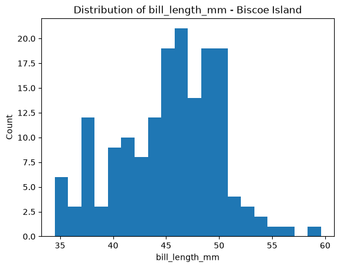
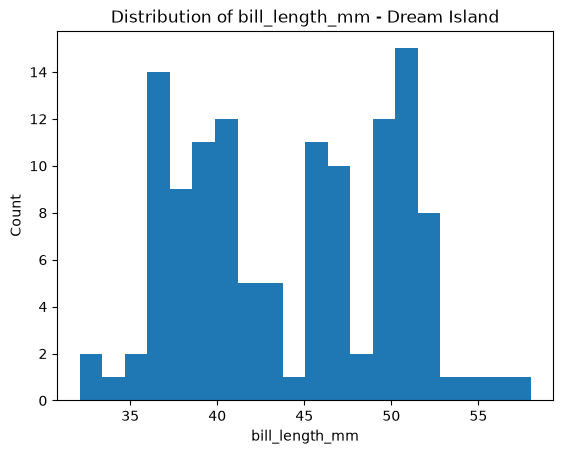
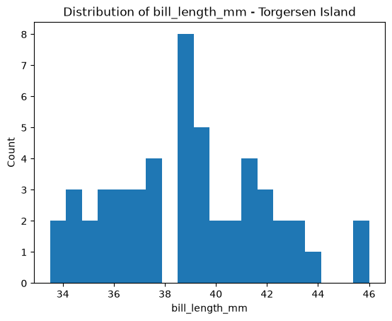

# Project Documentation

> Use this hosted documentation site to tell your
> data story. Include a narrative telling your
> results, observations, and interpretations.
> Display visuals as needed for a compelling story.

## Professional Workflow

See [**Workflow B: Apply Example Project**](https://denisecase.github.io/pro-analytics-02/workflow-b-apply-example-project/)
to get a project like this running on your machine.

## Professional Projects

- We code like the pros to help us **focus on the analytics**.
- Most files in this repository will never be touched.
- If curious about a file, check out the
  [Professional Python Project Explainer](https://denisecase.github.io/professional-python-project-explainer/).

## Documentation Index

- **Home** - this landing page
- [**Project Instructions**](./project-instructions.md)
- [**Concepts**](./concepts.md)
- [**Data Card**](./data-card.md)
- [**API**](./api.md)

## Bill Length Distribution by Island - 20260902 Changed by Holly Praiswater for Phase 5

I wanted to see the distribution for bill length once we categorized the penguins by island. I created a for loop to divide the penguins by island, then added a new code to give each island its own histogram.

### Biscoe Island

### Dream Island

### Torgersen Island

### Observations
Dream Island was still bimodal like the original graphs. Biscoe Island is the only distribution that is slightly skewed right, but a majority was from 45-50 mm, with a large amount of data being less than 45 mm. Torgersen was the closest to a normal distribution, but there was a gap in bill length around 38 mm, so that was interesting.
